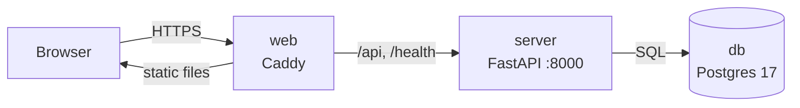
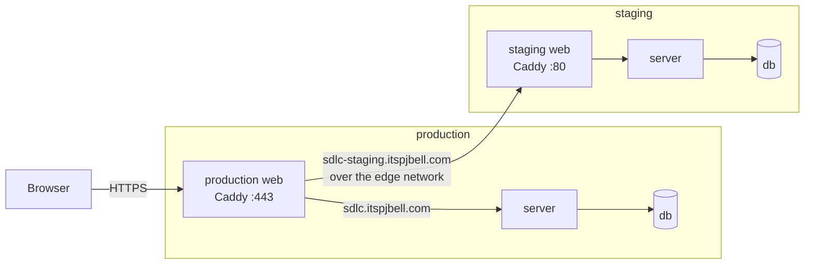

# modern-sdlc

A small app built to teach the whole software development lifecycle, from an
empty folder to a live server: local dev, GitHub, CI, container images, and an
automated deploy to a single VPS. The app itself is deliberately tiny (a button
that pings a FastAPI server, which records the ping in Postgres) so the
lifecycle around it stays the focus.

## How the repo is organized

1. **`apps/` run.** Each app becomes its own container and owns its Dockerfile.
2. **`packages/` are shared.** Code the apps import: the UI kit and the API types.
3. **The root wires it together.** Workspaces, the shared TypeScript config, and
   scripts that call into each app.



Only `web` is reachable from the internet. In local dev, Vite stands in for
Caddy and forwards `/api` and `/health` to the server.

## Environments

Every push deploys itself. `main` goes to **production**
(https://sdlc.itspjbell.com); any other branch goes to **staging**
(https://sdlc-staging.itspjbell.com). A PR can only merge once its commit has
passed on staging.

Both run on one VPS as separate stacks, each with its own database. Production's
Caddy is the only public container, so it fronts both domains:



How deploys, secrets and rollbacks work: [docs/deploy.md](docs/deploy.md).

## Prerequisites

- [Bun](https://bun.sh) for JavaScript and TypeScript
- [uv](https://docs.astral.sh/uv/) for Python
- [Docker Desktop](https://www.docker.com/products/docker-desktop/) for Postgres

## Run it locally

```bash
bun install
bun run db:up   # start Postgres in a container
bun run dev     # start the server (:8000) and the web app (:5173)
```

Open http://localhost:5173 and click **Say hello to the server**.

Other scripts: `bun run test`, `bun run typecheck`, `bun run build`,
`bun run db:psql`, and `bun run db:down`.
